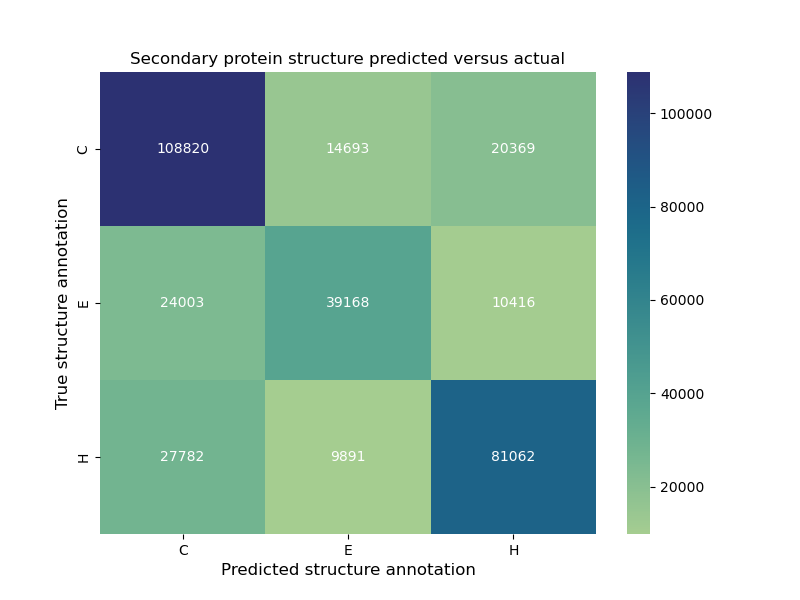

# Secondary protein structure prediction
### mini-project - Bioinformatics - Luca Wolfs

## Abstract
Predicting secondary protein structure based on the amino acid sequence has a long history in bioinformatics. 
To gain insight into how these predictions work, I used a simple convolutional neural network that considers neighbouring amino acids to predict secondary protein structure in three classes: 
alpha-helix (H), beta-strand (E) and other structures (C). I trained the model on a curated subset from the RCSB-PDB and was able to reach an accuracy of 68%. 
The subsequently created confusion matrix suggested that alpha-helices were predicted better than beta-strands, although the lack of normalisation in the matrix made it difficult to draw more definitive conclusions. 
Apart from the lack of normalisation, the lack of hyperparameter tuning and small dataset likely played a role in the relatively low accuracy score. 
Overall, the results suggests that a simple neural network that considers neighbouring amino acids is able to predict the structural annotation of individual amino acids. 

## Used data:
For this project, I  make use of a dataset containing a subset of protein data with their respective structural annotations from the Research Collaboratory for Structural Bioinformatics Protein Data Bank, 
that has been filtered using the Protein Sequence Culling Server (% identity cutoff: 25%, resolution cutoff: 2Å, R-factor cutoff: 0.25), available from this URL: https://www.kaggle.com/datasets/alfrandom/protein-secondary-structure/data.

## Methodology
Amino acid one-hot encoding. 
Sliding windows of 15 residues, kernel of 7 amino acids. 
1D convolutional neural network.
Three output classes: C (coils and other structures), E (beta-strands), H (alpha-helices). 

## Results:
68% test accuracy. 
Confusion Matrix:

